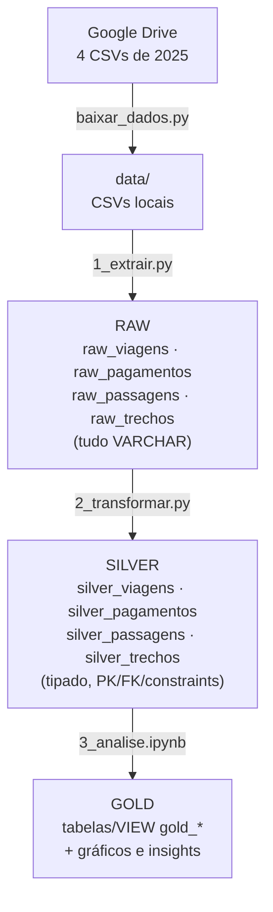
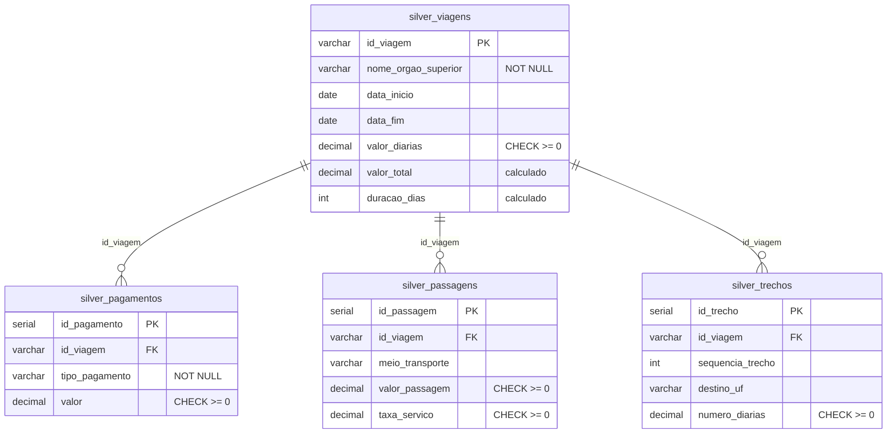

# Pipeline de Dados: Viagens a Serviço do Governo Federal

**Python + PostgreSQL + SQLAlchemy | Arquitetura Medallion (Raw → Silver → Gold)**
Análise de Dados com Python [T6] | Projeto Avaliativo do Módulo 1 (Semana 13)

**Autor:** Julcemar Justino Felipe

---

## 1. Sobre o projeto

### Qual problema ele resolve?

O Portal da Transparência do Governo Federal publica os dados de **Viagens a Serviço** em formato aberto, mas eles chegam **brutos**: texto com vírgula decimal, datas `DD/MM/AAAA`, encoding `latin-1`, colunas em excesso e registros repetidos. Nessa forma, ninguém consegue responder com segurança perguntas simples, como *quais órgãos mais gastam* ou *para onde se viaja mais*.

Este projeto constrói, do zero, um **pipeline ETL completo** que:

- baixa os dados da fonte, sem intervenção manual;
- preserva o dado original na camada **Raw**, para rastreabilidade e auditoria;
- limpa, tipa e relaciona os dados na camada **Silver**, com PK, FK e constraints;
- responde às perguntas de negócio na camada **Gold**, com tabelas, gráficos e uma agregação (tabela e VIEW) baseada em `JOIN` + `GROUP BY`.

**Escopo dos dados:** 6 meses de 2025 (arquivos `2025_Viagem.csv`, `2025_Pagamento.csv`, `2025_Passagem.csv` e `2025_Trecho.csv`).

---

## 2. Tecnologias e técnicas

| Tecnologia | Uso no projeto |
|---|---|
| **Python 3.10+** | Orquestração do pipeline (download, extração, transformação) |
| **PostgreSQL** | Armazenamento das camadas Raw, Silver e Gold |
| **SQLAlchemy + psycopg2** | Conexão com o banco, execução de SQL e carga em lote |
| **pandas** | Leitura dos CSVs em blocos (`chunksize`) e carga na Raw |
| **gdown** | Download automático dos arquivos a partir do Google Drive |
| **python-dotenv** | Credenciais fora do código (arquivo `.env`) |
| **matplotlib / seaborn** | Gráficos da camada Gold |
| **Jupyter Notebook** | Análise e visualização (`3_analise.ipynb`) |
| **Git / GitHub** | Versionamento do projeto |

**Técnicas aplicadas:** arquitetura Medallion, ETL, leitura em blocos, idempotência (`TRUNCATE`/`DELETE` antes de cada carga), tratamento de exceções (`try/except`), transações com `COMMIT`/`ROLLBACK`, deduplicação (`DISTINCT ON`), integridade referencial (PK, FK, `CHECK`, `NOT NULL`), conversão de tipos com regex e funções de agregação com `JOIN`.

---

## 3. Arquitetura



| Camada | O que é | Onde fica |
|---|---|---|
| **Raw** | Cópia fiel do CSV. Todas as colunas `VARCHAR`, mantendo vírgulas, datas `DD/MM/AAAA` e formatos originais | `raw_viagens`, `raw_pagamentos`, `raw_passagens`, `raw_trechos` |
| **Silver** | Dados limpos e tipados (`DECIMAL`, `DATE`, `INT`), com PK, FK e constraints | `silver_viagens`, `silver_pagamentos`, `silver_passagens`, `silver_trechos` |
| **Gold** | Métricas de negócio, agregações e gráficos | `3_analise.ipynb` + tabelas/VIEW `gold_*` |

### Modelo relacional da Silver



---

## 4. Estrutura do repositório

```
Projeto-Avaliativo-Modulo1-Julcemar_Justino_Felipe/
├── .env                  (credenciais locais, NÃO versionado)
├── .gitignore            (ignora .env, .zip, .csv, data/)
├── requirements.txt      (dependências Python)
├── config.py             (parâmetros + leitura do .env)
├── banco.py              (conexão e funções utilitárias do PostgreSQL)
├── baixar_dados.py       (download automático dos CSVs via gdown)
├── 0_criar_banco.sql     (DDL: 4 tabelas Raw + 4 tabelas Silver)
├── 0_criar_banco.py      (cria o database e executa o DDL)
├── 1_extrair.py          (Fase 1: CSV → Raw)
├── 2_transformar.py      (Fase 2: Raw → Silver)
├── 3_analise.ipynb       (Fase 3: Gold, perguntas de negócio e gráficos)
├── teste_extrair_amostra.py (teste da extração com amostra)
└── data/                 (CSVs baixados, ignorada pelo Git)
```

---

## 5. Como cada fase funciona

### Fase 0: banco e tabelas (`0_criar_banco.sql` / `0_criar_banco.py`)

Cria o database `viagens_transparencia` e as 8 tabelas:

- **Raw (4):** todas as colunas `VARCHAR`, sem constraints, replicando o CSV inteiro (inclusive colunas que a Silver não usa, como `cpf_viajante` e os dados de volta da passagem).
- **Silver (4):** tipadas, com `PRIMARY KEY`, `FOREIGN KEY` e constraints declaradas dentro do próprio `CREATE TABLE`.

| Tabela | Constraint 1 | Constraint 2 |
|---|---|---|
| `silver_viagens` | `NOT NULL` em `nome_orgao_superior` | `CHECK` em `valor_diarias >= 0` |
| `silver_pagamentos` | `CHECK` em `valor >= 0` | `NOT NULL` em `tipo_pagamento` |
| `silver_passagens` | `CHECK` em `valor_passagem >= 0` | `CHECK` em `taxa_servico >= 0` |
| `silver_trechos` | `CHECK` em `numero_diarias >= 0` | `UNIQUE` em `(id_viagem, sequencia_trecho)` |

### Download (`baixar_dados.py`)

Baixa a pasta do Google Drive com `gdown`, descompacta eventuais `.zip` e valida se os 4 CSVs esperados estão em `data/`.

### Fase 1: extração e camada Raw (`1_extrair.py`)

- Lê cada CSV com `sep=";"`, `encoding="latin-1"` e `dtype=str`, **em blocos de 50 mil linhas**, para não sobrecarregar a memória.
- Renomeia as colunas do portal para nomes padronizados (ex.: `Identificador do processo de viagem` → `id_viagem`).
- Converte vazios em `NULL` e grava em lote com `inserir_em_lote`, **sem alterar o conteúdo**.
- **Idempotente:** executa `TRUNCATE` antes de carregar, então reexecutar não duplica registros.
- **Resiliente:** `try/except` por arquivo, com mensagem clara em caso de falha.

### Fase 2: transformação e camada Silver (`2_transformar.py`)

Tudo ocorre em **uma única transação** (se algo falhar, `ROLLBACK` e o banco não fica pela metade). A ordem respeita as FKs: as tabelas filhas são limpas primeiro, e a tabela pai (`silver_viagens`) é carregada antes das filhas.

| Tratamento | Como é feito |
|---|---|
| Valores monetários (texto → `DECIMAL`) | Remove o ponto de milhar, troca a vírgula por ponto e faz `CAST`. Vazio vira `0.00` |
| Datas (texto → `DATE`) | Valida o formato com regex `^[0-9]{2}/[0-9]{2}/[0-9]{4}$` e aplica `TO_DATE(..., 'DD/MM/YYYY')`. Fora do padrão vira `NULL` |
| Deduplicação | `DISTINCT ON` por `id_viagem` e por `(id_viagem, sequencia_trecho)` |
| Integridade referencial | `INNER JOIN` com `silver_viagens`: filhos órfãos não entram |
| Texto | `TRIM` em todos os campos; nulos em `nome_orgao_superior` e `tipo_pagamento` viram `'Não informado'` |
| Valores negativos | `GREATEST(0, valor)` garante o respeito aos `CHECK` |

**Colunas calculadas em `silver_viagens`:**

```
valor_total  = valor_diarias + valor_passagens + valor_outros_gastos - valor_devolucao
duracao_dias = (data_fim - data_inicio) + 1
```

### Fase 3: camada Gold (`3_analise.ipynb`)

O notebook responde às perguntas de negócio com **consulta SQL + tabela + gráfico** e cria a camada Gold agregada (`JOIN` + `GROUP BY`), como **tabela e como VIEW**.

**Perguntas de negócio:**

1. Quais são os 5 órgãos com maior custo total?
2. Quais são os 3 destinos com maior custo médio por viagem?
3. Qual é a viagem de maior duração e qual foi o seu custo total?
4. Qual tipo de pagamento tem o maior valor médio?
5. Qual é o meio de transporte mais usado nos trechos?
6. Qual UF de destino aparece em mais trechos?
7. Qual órgão pagou mais no total?

---

## 6. Como executar

### Pré-requisitos

- Python 3.10 ou superior
- PostgreSQL 13 ou superior instalado e em execução
- Git

### Passo a passo

**1. Clone o repositório**

```bash
git clone https://github.com/julcemarfelipe/Projeto-Avaliativo-Modulo1-Julcemar_Justino_Felipe.git
cd Projeto-Avaliativo-Modulo1-Julcemar_Justino_Felipe
```

**2. Crie e ative o ambiente virtual**

```bash
# Windows (PowerShell)
python -m venv venv
.\venv\Scripts\Activate.ps1

# macOS / Linux
python3 -m venv venv
source venv/bin/activate
```

**3. Instale as dependências**

```bash
pip install -r requirements.txt
```

**4. Configure as credenciais**

Crie um arquivo `.env` na raiz (use o `.env.example` como modelo), com a senha que você definiu na instalação do PostgreSQL:

```env
PG_HOST=localhost
PG_PORT=5432
PG_USER=postgres
PG_PASSWORD=sua_senha_aqui
PG_DATABASE=viagens_transparencia
```

> ⚠️ O `.env` está no `.gitignore`. Nunca versione suas credenciais.

**5. Baixe os dados**

```bash
python baixar_dados.py
```

Se o Google Drive bloquear por cota temporária, baixe os 4 CSVs pelo navegador e salve em `data/`.

**6. Execute o pipeline na ordem**

```bash
python 0_criar_banco.py     # Fase 0: cria o banco e as 8 tabelas
python 1_extrair.py         # Fase 1: CSVs → Raw
python 2_transformar.py     # Fase 2: Raw → Silver
jupyter notebook            # Fase 3: abra e execute o 3_analise.ipynb
```

### Validação rápida

Após as fases 1 e 2, confira a contagem de linhas no banco:

```sql
SELECT 'raw_viagens' AS tabela, COUNT(*) FROM raw_viagens
UNION ALL SELECT 'silver_viagens', COUNT(*) FROM silver_viagens
UNION ALL SELECT 'silver_pagamentos', COUNT(*) FROM silver_pagamentos
UNION ALL SELECT 'silver_passagens', COUNT(*) FROM silver_passagens
UNION ALL SELECT 'silver_trechos', COUNT(*) FROM silver_trechos;
```

A Raw deve ter **mais ou igual** linhas que a Silver, pois a Silver remove duplicidades e registros órfãos.

---

## 7. Resultados e insights

<!-- PREENCHER com os números reais do seu notebook (3_analise.ipynb).
     Sugestão: um parágrafo curto por pergunta, com o valor encontrado e uma interpretação. -->

| # | Pergunta | Resposta | Insight |
|---|---|---|---|
| 1 | 5 órgãos com maior custo total | _preencher_ | _preencher_ |
| 2 | 3 destinos com maior custo médio por viagem | _preencher_ | _preencher_ |
| 3 | Viagem de maior duração e custo total | _preencher_ | _preencher_ |
| 4 | Tipo de pagamento com maior valor médio | _preencher_ | _preencher_ |
| 5 | Meio de transporte mais usado nos trechos | _preencher_ | _preencher_ |
| 6 | UF de destino em mais trechos | _preencher_ | _preencher_ |
| 7 | Órgão que mais pagou no total | _preencher_ | _preencher_ |

<!-- Opcional: salve os gráficos do notebook em uma pasta imagens/ e exiba aqui:
 -->

### Conclusões

<!-- PREENCHER: 3 a 5 conclusões que ligam os gráficos às decisões que o governo poderia tomar. -->

---

## 8. Melhorias futuras

- **Agendamento automático** do pipeline (cron, Airflow ou Prefect) para atualização periódica.
- **Carga incremental** em vez de `TRUNCATE` + recarga total, reduzindo o tempo em bases maiores.
- **Tabela de rejeitados:** registrar as linhas descartadas na Silver (órfãs, datas inválidas) em vez de apenas descartá-las.
- **Testes automatizados** (pytest) para as funções de conversão de valores e datas.
- **Logging estruturado** (`logging`) no lugar de `print`, com arquivo de log por execução.
- **Containerização** com Docker Compose (PostgreSQL + Python) para reprodução com um único comando.
- **Dashboard** interativo (Power BI, Metabase ou Streamlit) sobre a camada Gold.
- **Ampliar o período** para o ano completo e outros anos, com particionamento das tabelas.

---

## 9. Boas práticas adotadas

- Credenciais apenas no `.env`, fora do código e do Git.
- `.gitignore` adequado (`.env`, `.zip`, `.csv`, `data/`).
- Código modularizado (`config.py`, `banco.py`) e seguindo a PEP-8.
- Scripts numerados pela ordem de execução.
- Commits curtos e diretos, no imperativo ("implementa X", "corrige Y").

---

## 10. Fonte dos dados

[Portal da Transparência do Governo Federal: Viagens a Serviço](https://portaldatransparencia.gov.br/viagens)
