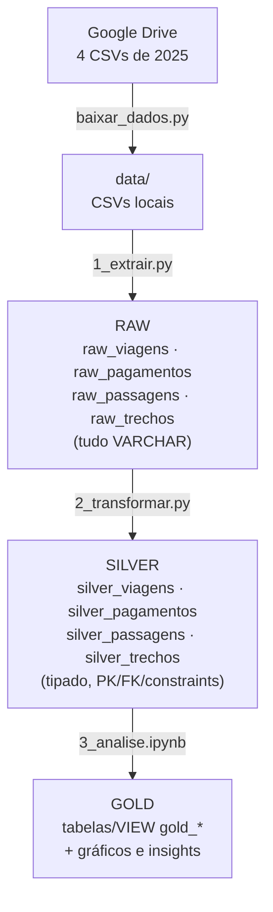
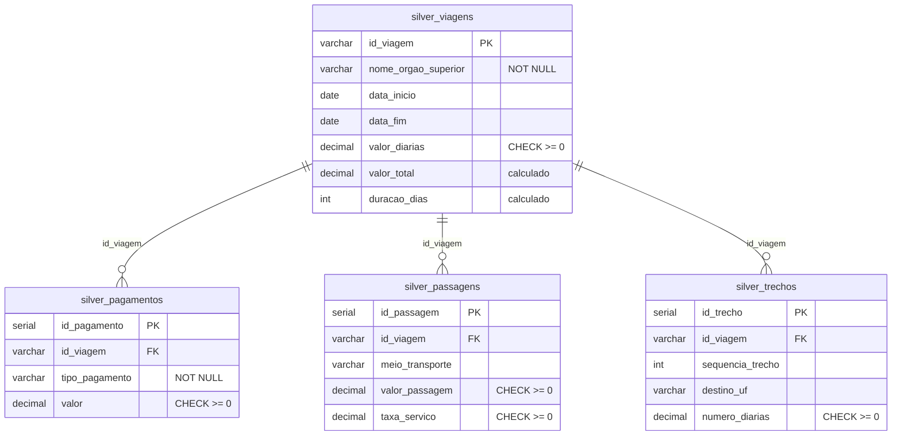
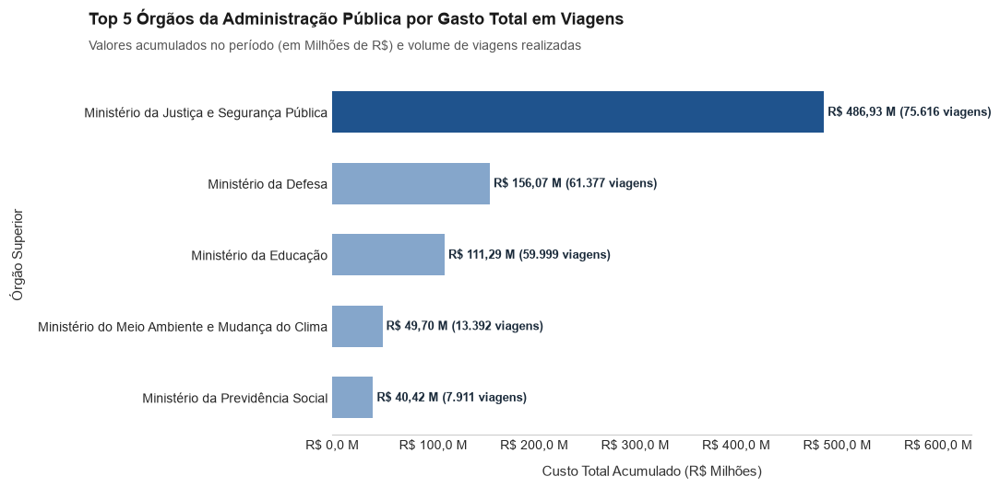
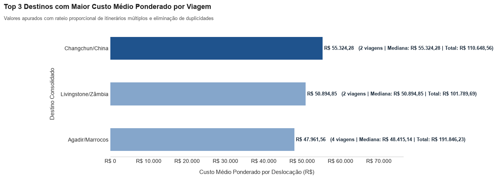
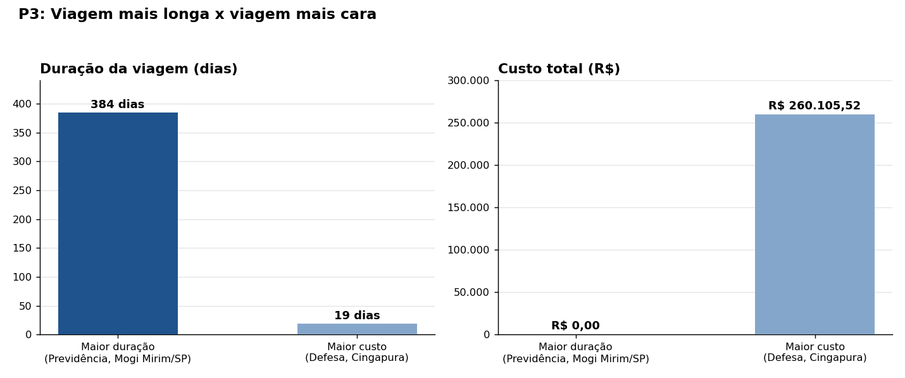
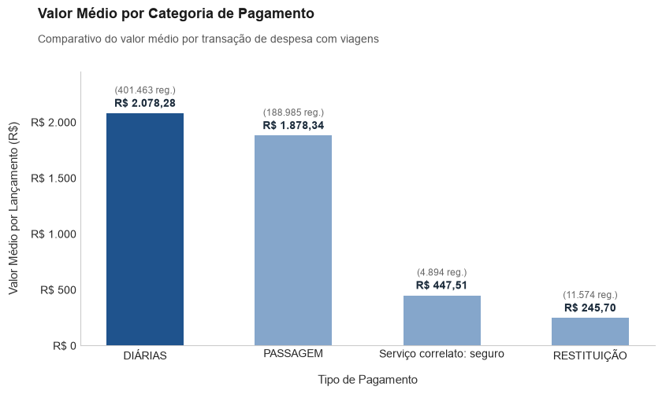
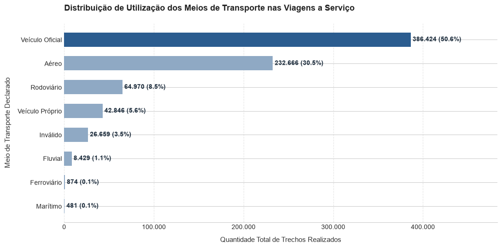
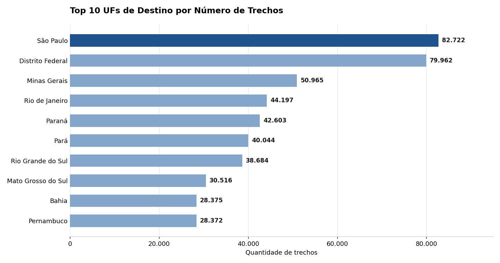
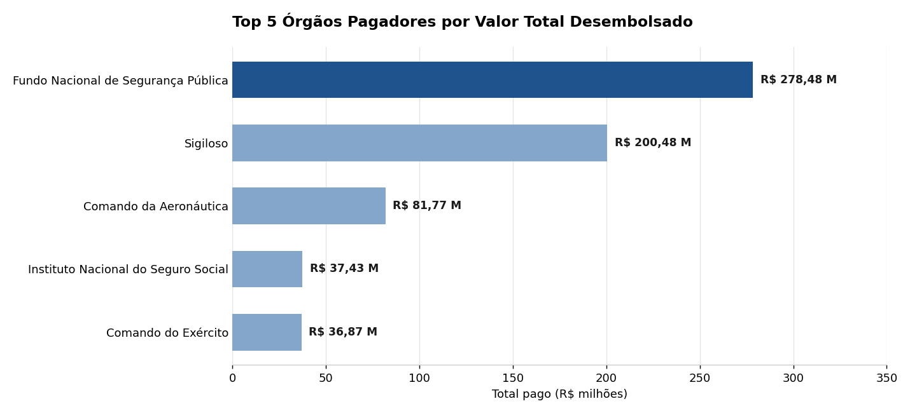

# ✈️ Pipeline de Dados: Viagens a Serviço do Governo Federal

**Python + PostgreSQL + SQLAlchemy | Arquitetura Medallion (Raw → Silver → Gold)**
Análise de Dados com Python [T6] | Projeto Avaliativo do Módulo 1 (Semana 13)

**Autor:** Julcemar Justino Felipe

---

## 📌 1. Sobre o projeto

### ❓ Qual problema ele resolve?

O Portal da Transparência do Governo Federal publica os dados de **Viagens a Serviço** em formato aberto, mas eles chegam **brutos**: texto com vírgula decimal, datas `DD/MM/AAAA`, encoding `latin-1`, colunas em excesso e registros repetidos. Nessa forma, ninguém consegue responder com segurança perguntas simples, como *quais órgãos mais gastam* ou *para onde se viaja mais*.

Este projeto constrói, do zero, um **pipeline ETL completo** que:

- baixa os dados da fonte, sem intervenção manual;
- preserva o dado original na camada **Raw**, para rastreabilidade e auditoria;
- limpa, tipa e relaciona os dados na camada **Silver**, com PK, FK e constraints;
- responde às perguntas de negócio na camada **Gold**, com tabelas, gráficos e uma agregação (tabela e VIEW) baseada em `JOIN` + `GROUP BY`.

**Escopo dos dados:** 6 meses de 2025 (arquivos `2025_Viagem.csv`, `2025_Pagamento.csv`, `2025_Passagem.csv` e `2025_Trecho.csv`).

---

## 🛠️ 2. Tecnologias e técnicas

| Tecnologia | Uso no projeto |
|---|---|
| **Python 3.10+** | Orquestração do pipeline (download, extração, transformação) |
| **PostgreSQL** | Armazenamento das camadas Raw, Silver e Gold |
| **SQLAlchemy + psycopg2** | Conexão com o banco, execução de SQL e carga em lote |
| **pandas** | Leitura dos CSVs em blocos (`chunksize`) e carga na Raw |
| **gdown** | Download automático dos arquivos a partir do Google Drive |
| **python-dotenv** | Credenciais fora do código (arquivo `.env`) |
| **matplotlib / seaborn** | Gráficos da camada Gold |
| **Jupyter Notebook** | Análise e visualização (`3_analise.ipynb`) |
| **Git / GitHub** | Versionamento do projeto |

**Técnicas aplicadas:** arquitetura Medallion, ETL, leitura em blocos, idempotência (`TRUNCATE`/`DELETE` antes de cada carga), tratamento de exceções (`try/except`), transações com `COMMIT`/`ROLLBACK`, deduplicação (`DISTINCT ON`), integridade referencial (PK, FK, `CHECK`, `NOT NULL`), conversão de tipos com regex e funções de agregação com `JOIN`.

---

## 🏗️ 3. Arquitetura



| Camada | O que é | Onde fica |
|---|---|---|
| 🟤 **Raw** | Cópia fiel do CSV. Todas as colunas `VARCHAR`, mantendo vírgulas, datas `DD/MM/AAAA` e formatos originais | `raw_viagens`, `raw_pagamentos`, `raw_passagens`, `raw_trechos` |
| ⚪ **Silver** | Dados limpos e tipados (`DECIMAL`, `DATE`, `INT`), com PK, FK e constraints | `silver_viagens`, `silver_pagamentos`, `silver_passagens`, `silver_trechos` |
| 🟡 **Gold** | Métricas de negócio, agregações e gráficos | `3_analise.ipynb` + tabelas/VIEW `gold_*` |

### 🗂️ Modelo relacional da Silver



---

## 📁 4. Estrutura do repositório

```
Projeto-Avaliativo-Modulo1-Julcemar_Justino_Felipe/
├── .env                  (credenciais locais, NÃO versionado)
├── .gitignore            (ignora .env, .zip, .csv, data/)
├── requirements.txt      (dependências Python)
├── config.py             (parâmetros + leitura do .env)
├── banco.py              (conexão e funções utilitárias do PostgreSQL)
├── baixar_dados.py       (download automático dos CSVs via gdown)
├── 0_criar_banco.sql     (DDL: 4 tabelas Raw + 4 tabelas Silver)
├── 0_criar_banco.py      (cria o database e executa o DDL)
├── 1_extrair.py          (Fase 1: CSV → Raw)
├── 2_transformar.py      (Fase 2: Raw → Silver)
├── 3_analise.ipynb       (Fase 3: Gold, perguntas de negócio e gráficos)
├── teste_extrair_amostra.py (teste da extração com amostra)
├── imagens/              (gráficos usados neste README)
└── data/                 (CSVs baixados, ignorada pelo Git)
```

---

## ⚙️ 5. Como cada fase funciona

### 🧱 Fase 0: banco e tabelas (`0_criar_banco.sql` / `0_criar_banco.py`)

Cria o database `viagens_transparencia` e as 8 tabelas:

- **Raw (4):** todas as colunas `VARCHAR`, sem constraints, replicando o CSV inteiro (inclusive colunas que a Silver não usa, como `cpf_viajante` e os dados de volta da passagem).
- **Silver (4):** tipadas, com `PRIMARY KEY`, `FOREIGN KEY` e constraints declaradas dentro do próprio `CREATE TABLE`.

| Tabela | Constraint 1 | Constraint 2 |
|---|---|---|
| `silver_viagens` | `NOT NULL` em `nome_orgao_superior` | `CHECK` em `valor_diarias >= 0` |
| `silver_pagamentos` | `CHECK` em `valor >= 0` | `NOT NULL` em `tipo_pagamento` |
| `silver_passagens` | `CHECK` em `valor_passagem >= 0` | `CHECK` em `taxa_servico >= 0` |
| `silver_trechos` | `CHECK` em `numero_diarias >= 0` | `UNIQUE` em `(id_viagem, sequencia_trecho)` |

### ⬇️ Download (`baixar_dados.py`)

Baixa a pasta do Google Drive com `gdown`, descompacta eventuais `.zip` e valida se os 4 CSVs esperados estão em `data/`.

### 📥 Fase 1: extração e camada Raw (`1_extrair.py`)

- Lê cada CSV com `sep=";"`, `encoding="latin-1"` e `dtype=str`, **em blocos de 50 mil linhas**, para não sobrecarregar a memória.
- Renomeia as colunas do portal para nomes padronizados (ex.: `Identificador do processo de viagem` → `id_viagem`).
- Converte vazios em `NULL` e grava em lote com `inserir_em_lote`, **sem alterar o conteúdo**.
- **Idempotente:** executa `TRUNCATE` antes de carregar, então reexecutar não duplica registros.
- **Resiliente:** `try/except` por arquivo, com mensagem clara em caso de falha.

### 🥈 Fase 2: transformação e camada Silver (`2_transformar.py`)

Tudo ocorre em **uma única transação** (se algo falhar, `ROLLBACK` e o banco não fica pela metade). A ordem respeita as FKs: as tabelas filhas são limpas primeiro, e a tabela pai (`silver_viagens`) é carregada antes das filhas.

| Tratamento | Como é feito |
|---|---|
| Valores monetários (texto → `DECIMAL`) | Remove o ponto de milhar, troca a vírgula por ponto e faz `CAST`. Vazio vira `0.00` |
| Datas (texto → `DATE`) | Valida o formato com regex `^[0-9]{2}/[0-9]{2}/[0-9]{4}$` e aplica `TO_DATE(..., 'DD/MM/YYYY')`. Fora do padrão vira `NULL` |
| Deduplicação | `DISTINCT ON` por `id_viagem` e por `(id_viagem, sequencia_trecho)` |
| Integridade referencial | `INNER JOIN` com `silver_viagens`: filhos órfãos não entram |
| Texto | `TRIM` em todos os campos; nulos em `nome_orgao_superior` e `tipo_pagamento` viram `'Não informado'` |
| Valores negativos | `GREATEST(0, valor)` garante o respeito aos `CHECK` |

**Colunas calculadas em `silver_viagens`:**

```
valor_total  = valor_diarias + valor_passagens + valor_outros_gastos - valor_devolucao
duracao_dias = (data_fim - data_inicio) + 1
```

### 🥇 Fase 3: camada Gold (`3_analise.ipynb`)

O notebook responde às perguntas de negócio com **consulta SQL + tabela + gráfico** e cria a camada Gold agregada (`JOIN` + `GROUP BY`), como **tabela e como VIEW**.

**🎯 Perguntas de negócio:**

1. Quais são os 5 órgãos com maior custo total?
2. Quais são os 3 destinos com maior custo médio por viagem?
3. Qual é a viagem de maior duração e qual foi o seu custo total?
4. Qual tipo de pagamento tem o maior valor médio?
5. Qual é o meio de transporte mais usado nos trechos?
6. Qual UF de destino aparece em mais trechos?
7. Qual órgão pagou mais no total?

---

## ▶️ 6. Como executar

### ✅ Pré-requisitos

- Python 3.10 ou superior
- PostgreSQL 13 ou superior instalado e em execução
- Git

### 🚀 Passo a passo

**1. Clone o repositório**

```bash
git clone https://github.com/julcemarfelipe/Projeto-Avaliativo-Modulo1-Julcemar_Justino_Felipe.git
cd Projeto-Avaliativo-Modulo1-Julcemar_Justino_Felipe
```

**2. Crie e ative o ambiente virtual**

```bash
# Windows (PowerShell)
python -m venv venv
.\venv\Scripts\Activate.ps1

# macOS / Linux
python3 -m venv venv
source venv/bin/activate
```

**3. Instale as dependências**

```bash
pip install -r requirements.txt
```

**4. Configure as credenciais**

Crie um arquivo `.env` na raiz (use o `.env.example` como modelo), com a senha que você definiu na instalação do PostgreSQL:

```env
PG_HOST=localhost
PG_PORT=5432
PG_USER=postgres
PG_PASSWORD=sua_senha_aqui
PG_DATABASE=viagens_transparencia
```

> ⚠️ O `.env` está no `.gitignore`. Nunca versione suas credenciais.

**5. Baixe os dados**

```bash
python baixar_dados.py
```

Se o Google Drive bloquear por cota temporária, baixe os 4 CSVs pelo navegador e salve em `data/`.

**6. Execute o pipeline na ordem**

```bash
python 0_criar_banco.py     # Fase 0: cria o banco e as 8 tabelas
python 1_extrair.py         # Fase 1: CSVs → Raw
python 2_transformar.py     # Fase 2: Raw → Silver
jupyter notebook            # Fase 3: abra e execute o 3_analise.ipynb
```

### 🔍 Validação rápida

Após as fases 1 e 2, confira a contagem de linhas no banco:

```sql
SELECT 'raw_viagens' AS tabela, COUNT(*) FROM raw_viagens
UNION ALL SELECT 'silver_viagens', COUNT(*) FROM silver_viagens
UNION ALL SELECT 'silver_pagamentos', COUNT(*) FROM silver_pagamentos
UNION ALL SELECT 'silver_passagens', COUNT(*) FROM silver_passagens
UNION ALL SELECT 'silver_trechos', COUNT(*) FROM silver_trechos;
```

A Raw deve ter **mais ou igual** linhas que a Silver, pois a Silver remove duplicidades e registros órfãos.

---

## 📊 7. Resultados e insights

Todos os números abaixo vêm da execução real do `3_analise.ipynb` sobre os 6 meses de 2025. Cada pergunta é respondida com **consulta SQL sobre a Silver + tabela + gráfico**.

### 🧾 Resumo das respostas

| # | Pergunta | Resposta | Insight |
|---|---|---|---|
| 1 | 5 órgãos com maior custo total | **Ministério da Justiça e Segurança Pública** lidera com R$ 486,93 mi (75.616 viagens), seguido de Defesa, Educação, Meio Ambiente e Previdência | Sozinho, o MJSP concentra cerca de 58% da soma dos 5 maiores e gasta ~3,1x mais que o segundo colocado |
| 2 | 3 destinos com maior custo médio por viagem | **Changchun/China** (R$ 55.324,28), **Livingstone/Zâmbia** (R$ 50.894,85) e **Agadir/Marrocos** (R$ 47.961,56) | Os três são destinos internacionais, mas com poucas viagens (2, 2 e 4): a média é sensível a poucos casos |
| 3 | Viagem de maior duração e custo total | **384 dias** (Previdência Social, Mogi Mirim/SP, 13/01/2025 a 31/01/2026), com custo de **R$ 0,00** | A viagem mais longa não gerou custo; já a mais cara foi a do Ministério da Defesa a Cingapura (19 dias, R$ 260.105,52) |
| 4 | Tipo de pagamento com maior valor médio | **Diárias**, com R$ 2.078,28 por lançamento | Diárias respondem por ~70% de todo o valor pago, à frente de passagens (R$ 1.878,34 de média) |
| 5 | Meio de transporte mais usado nos trechos | **Veículo Oficial**, com 386.424 trechos (50,6%) | A frota oficial supera o transporte aéreo (30,5%); 3,5% dos trechos estão como "Inválido" |
| 6 | UF de destino em mais trechos | **São Paulo**, com 82.722 trechos | O Distrito Federal vem logo atrás (79.962), uma diferença de apenas ~3,4% |
| 7 | Órgão que mais pagou no total | **Fundo Nacional de Segurança Pública**, com R$ 278,48 mi | O 2º lugar é "Sigiloso" (R$ 200,48 mi), valor que não permite identificar o pagador |

---

### 🏛️ P1. Os 5 órgãos com maior custo total



| Órgão | Viagens | Custo total |
|---|---:|---:|
| Ministério da Justiça e Segurança Pública | 75.616 | R$ 486.933.121,65 |
| Ministério da Defesa | 61.377 | R$ 156.070.304,49 |
| Ministério da Educação | 59.999 | R$ 111.291.402,82 |
| Ministério do Meio Ambiente e Mudança do Clima | 13.392 | R$ 49.697.710,16 |
| Ministério da Previdência Social | 7.911 | R$ 40.417.309,06 |

**📝 Análise:** o Ministério da Justiça e Segurança Pública é o maior gastador com folga, e o motivo não é só o volume. Dividindo o custo pelo número de viagens, o custo médio do MJSP é de cerca de R$ 6.440 por viagem, contra ~R$ 2.540 da Defesa e ~R$ 1.855 da Educação. Ou seja, o MJSP faz mais viagens **e** viagens mais caras. Já a Previdência Social aparece em 5º lugar com apenas 7.911 viagens, mas com custo médio alto (~R$ 5.110), o que sugere deslocamentos mais caros por viagem.

---

### 🌍 P2. Os 3 destinos com maior custo médio por viagem



| Destino | Viagens | Custo médio | Mediana | Gasto total |
|---|---:|---:|---:|---:|
| Changchun/China | 2 | R$ 55.324,28 | R$ 55.324,28 | R$ 110.648,56 |
| Livingstone/Zâmbia | 2 | R$ 50.894,85 | R$ 50.894,85 | R$ 101.789,69 |
| Agadir/Marrocos | 4 | R$ 47.961,56 | R$ 48.415,14 | R$ 191.846,23 |

**📝 Análise:** o custo médio é calculado com **rateio proporcional** do valor da viagem entre os destinos, para que itinerários com várias paradas não inflem um único destino. Os três primeiros são internacionais e distantes, o que explica passagens e diárias mais altas. Como cada destino tem só 2 a 4 viagens, o ranking diz mais sobre **viagens pontuais e caras** do que sobre um padrão recorrente. Para decisões, vale cruzar com o volume de viagens.

---

### ⏱️ P3. A viagem de maior duração e o seu custo total



| | Viagem de maior duração | Viagem de maior custo |
|---|---|---|
| **ID** | 0000000000020699856 | 0000000000020914280 |
| **Órgão** | Ministério da Previdência Social | Ministério da Defesa |
| **Destino** | Mogi Mirim/SP | Cingapura/Cingapura |
| **Período** | 13/01/2025 a 31/01/2026 | 16/05/2025 a 03/06/2025 |
| **Duração** | **384 dias** | 19 dias |
| **Custo total** | **R$ 0,00** | R$ 260.105,52 |

**📝 Análise:** a viagem mais longa dura mais de um ano e tem custo zero, e o período termina em 2026, além da janela de 6 meses analisada. Isso indica um deslocamento de longa duração registrado **sem diárias nem passagens** (por exemplo, um afastamento com custo assumido por outra rubrica), e não uma viagem "cara". Duração e custo, portanto, **não andam juntos**: a viagem mais cara é curta (19 dias), mas internacional, e custa mais de R$ 260 mil. Vale tratar durações extremas como possíveis anomalias de cadastro.

---

### 💳 P4. Tipo de pagamento com maior valor médio



| Tipo de pagamento | Lançamentos | Valor médio | Valor total |
|---|---:|---:|---:|
| **DIÁRIAS** | 401.463 | R$ 2.078,28 | R$ 834.352.643,52 |
| PASSAGEM | 188.985 | R$ 1.878,34 | R$ 354.978.915,13 |
| Serviço correlato: seguro | 4.894 | R$ 447,51 | R$ 2.190.136,71 |
| RESTITUIÇÃO | 11.574 | R$ 245,70 | R$ 2.843.762,01 |

**📝 Análise:** diárias são o pagamento de maior valor médio **e** o de maior volume: são 401 mil lançamentos e ~R$ 834 mi, cerca de 70% de todo o valor pago. Isso mostra que o principal custo das viagens não está no deslocamento (passagens), e sim na **permanência** do servidor no destino. Qualquer política de redução de gastos tende a ter mais efeito atuando sobre diárias (número de dias, valor por localidade) do que sobre passagens.

---

### 🚗 P5. Meio de transporte mais usado nos trechos



| Meio de transporte | Trechos | % |
|---|---:|---:|
| **Veículo Oficial** | 386.424 | 50,6% |
| Aéreo | 232.666 | 30,5% |
| Rodoviário | 64.970 | 8,5% |
| Veículo Próprio | 42.846 | 5,6% |
| Inválido | 26.659 | 3,5% |
| Fluvial | 8.429 | 1,1% |
| Ferroviário | 874 | 0,1% |
| Marítimo | 481 | 0,1% |

**📝 Análise:** metade dos trechos é feita em veículo oficial, o que é coerente com deslocamentos curtos e locais (fiscalização, atendimento, trabalho de campo). O transporte aéreo vem em segundo, com 30,5%. A categoria **"Inválido"** (3,5%, ou 26.659 trechos) é um problema de qualidade na fonte: são trechos sem meio de transporte identificável, que poderiam ser tratados ou sinalizados na Silver.

---

### 🗺️ P6. UF de destino em mais trechos



| # | UF de destino | Trechos |
|---:|---|---:|
| 1 | **São Paulo** | 82.722 |
| 2 | Distrito Federal | 79.962 |
| 3 | Minas Gerais | 50.965 |
| 4 | Rio de Janeiro | 44.197 |
| 5 | Paraná | 42.603 |
| 6 | Pará | 40.044 |
| 7 | Rio Grande do Sul | 38.684 |
| 8 | Mato Grosso do Sul | 30.516 |
| 9 | Bahia | 28.375 |
| 10 | Pernambuco | 28.372 |

**📝 Análise:** São Paulo e Distrito Federal formam um bloco à parte, com quase o dobro de trechos do 3º colocado (Minas Gerais). O destaque do DF é esperado por ser a sede do governo federal, e o de SP reflete o peso econômico e a concentração de eventos e órgãos. A presença do Pará (6º) e do Mato Grosso do Sul (8º) acima de estados mais populosos mostra o efeito de atividades específicas, como fiscalização ambiental, fronteira e operações de campo.

---

### 💰 P7. Órgão que mais pagou no total



| Órgão pagador | Pagamentos | Total pago |
|---|---:|---:|
| **Fundo Nacional de Segurança Pública** | 79.816 | R$ 278.481.047,89 |
| Sigiloso | 93.141 | R$ 200.484.801,68 |
| Comando da Aeronáutica | 46.193 | R$ 81.769.144,77 |
| Instituto Nacional do Seguro Social | 18.324 | R$ 37.427.601,45 |
| Comando do Exército | 22.837 | R$ 36.872.643,95 |

**📝 Análise:** o Fundo Nacional de Segurança Pública é o maior pagador, o que combina com a liderança do Ministério da Justiça e Segurança Pública em custo total (P1). O dado mais relevante, porém, é o segundo lugar: **"Sigiloso"** soma R$ 200 mi em 93 mil pagamentos, o maior número de lançamentos de todos. Esse valor não pode ser atribuído a nenhum órgão, o que limita a transparência da análise.

---

### 🧪 Auditoria das camadas

| Camada | Tabela | Linhas |
|---|---|---:|
| 🟤 Raw | `raw_viagens` | 341.860 |
| 🟤 Raw | `raw_pagamentos` | 606.916 |
| 🟤 Raw | `raw_passagens` | 167.260 |
| 🟤 Raw | `raw_trechos` | 763.349 |
| ⚪ Silver | `silver_viagens` | 341.860 |
| ⚪ Silver | `silver_pagamentos` | 606.916 |
| ⚪ Silver | `silver_passagens` | 167.260 |
| ⚪ Silver | `silver_trechos` | 763.349 |
| 🟡 Gold | `gold_resumo_orgaos` | 35 |

A contagem da Silver é igual à da Raw nas quatro tabelas, ou seja, **nenhuma linha foi descartada** por duplicidade ou por ficar órfã nesta carga. A Gold resume tudo em 35 órgãos superiores.

---

### 💡 Conclusões

1. 🎯 **O custo está concentrado.** O Ministério da Justiça e Segurança Pública gasta ~R$ 487 mi, mais que o dobro de qualquer outro órgão, e é o maior em volume **e** em custo médio por viagem. Auditorias e metas de economia rendem mais se começarem por ele.
2. 💵 **Diárias são o principal vetor de custo.** Com ~70% do valor pago, rever regras de duração e valor das diárias tende a ter mais efeito do que negociar passagens.
3. 🚙 **A maior parte da operação é local.** Metade dos trechos usa veículo oficial, e SP e DF concentram os destinos. O custo do dia a dia vem de muitos deslocamentos de rotina, e não de grandes viagens internacionais.
4. 🌐 **Viagens internacionais pesam por caso, não por volume.** Os destinos mais caros por média (China, Zâmbia, Marrocos) têm poucas viagens, e a viagem mais cara do período (Cingapura, R$ 260 mil) é um caso isolado.
5. ⚠️ **Há lacunas de transparência e qualidade nos dados.** Os pagamentos "Sigiloso" (R$ 200 mi), os trechos com meio "Inválido" (26.659) e uma viagem de 384 dias sem custo mostram onde a fonte precisa de validação ou de uma tabela de rejeitados (ver melhorias futuras).

---

## 🌟 8. Boas práticas adotadas

- Credenciais apenas no `.env`, fora do código e do Git.
- `.gitignore` adequado (`.env`, `.zip`, `.csv`, `data/`).
- Código modularizado (`config.py`, `banco.py`) e seguindo a PEP-8.
- Scripts numerados pela ordem de execução.
- Commits curtos e diretos, no imperativo ("implementa X", "corrige Y").
---

## 📚 9. Referências

### 🗃️ Fonte dos dados

- CONTROLADORIA-GERAL DA UNIÃO. **Portal da Transparência do Governo Federal: Viagens a Serviço**. Brasília: CGU, 2025. Disponível em: <https://portaldatransparencia.gov.br/viagens>. Acesso em: 30 out. 2026.

### 📖 Documentação técnica

- THE POSTGRESQL GLOBAL DEVELOPMENT GROUP. **PostgreSQL 18 Documentation**. Disponível em: <https://www.postgresql.org/docs/18/> (versão em PDF: <https://www.postgresql.org/files/documentation/pdf/18/postgresql-18-A4.pdf>). Consultado principalmente para `SELECT ... DISTINCT ON`, `TO_DATE`, restrições (`PRIMARY KEY`, `FOREIGN KEY`, `CHECK`) e transações.
- PANDAS DEVELOPMENT TEAM. **pandas documentation**. Disponível em: <https://pandas.pydata.org/docs/>. Leitura de CSV em blocos (`chunksize`) e `read_sql`.
- SQLALCHEMY. **SQLAlchemy documentation**. Disponível em: <https://docs.sqlalchemy.org/>. Conexão, transações e execução de SQL.
- PSYCOPG. **Psycopg 2 documentation**. Disponível em: <https://www.psycopg.org/docs/>. Driver de conexão com o PostgreSQL.
- MATPLOTLIB DEVELOPMENT TEAM. **Matplotlib documentation**. Disponível em: <https://matplotlib.org/stable/>.
- WASKOM, M. **seaborn: statistical data visualization**. Disponível em: <https://seaborn.pydata.org/>.
- WKENTARO. **gdown**: download de arquivos do Google Drive. Disponível em: <https://github.com/wkentaro/gdown>.
- SKUMAR, Saurabh. **python-dotenv**: leitura de variáveis de ambiente a partir de arquivos `.env`. Disponível em: <https://github.com/theskumar/python-dotenv>.
- **Mermaid**: diagramas a partir de texto (usado na arquitetura e no modelo relacional). Disponível em: <https://mermaid.js.org/>.

### 🧠 Conceitos

- DATABRICKS. **What is a Medallion Architecture?** Disponível em: <https://www.databricks.com/glossary/medallion-architecture>. Base conceitual das camadas Raw (Bronze), Silver e Gold.

### 🤖 Ferramentas de apoio (IA generativa)

- ANTHROPIC. **Claude Sonnet 5.5** [Modelo de linguagem de grande escala]. São Francisco: Anthropic, 2026. Disponível em: <https://claude.ai>. Acesso em: 30 out. 2026. Utilizado como apoio na redação dos resultados e insights, na geração dos gráficos das perguntas P3, P6 e P7 e na revisão da documentação técnica. Todo o código, as execuções e os resultados foram conferidos pelo autor.

### 🎓 Material da disciplina

- **Análise de Dados com Python** (Turma T6), Módulo 1.